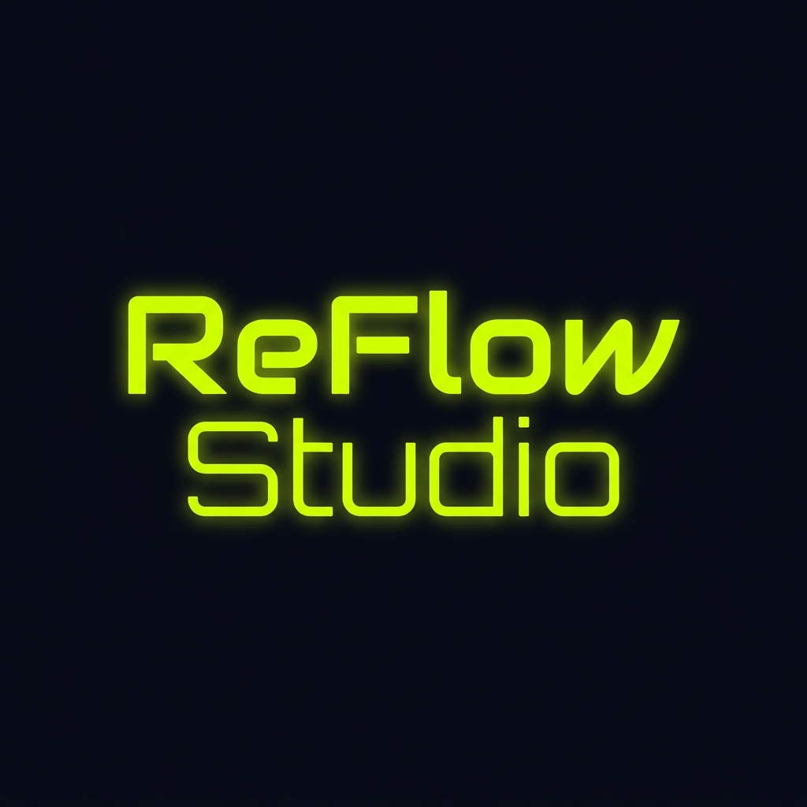
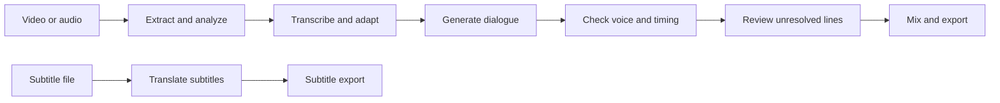

<div align="center">
  
  <h1>ReFlow Studio</h1>
  <p><strong>Bring your dialogue into another language. Keep the scene in view.</strong></p>
  <p>A desktop workspace for transcription, translation, voice generation, dialogue review and media export.</p>

  [](https://github.com/ananta-sj/ReFlow-Studio/actions/workflows/build.yml)
  [](LICENSE)
  
  
  

  **[Download Desktop Preview](https://github.com/ananta-sj/ReFlow-Studio/releases/latest)** · **[All releases](https://github.com/ananta-sj/ReFlow-Studio/releases)** · **[Builds](https://github.com/ananta-sj/ReFlow-Studio/actions)** · **[Feedback](https://github.com/ananta-sj/ReFlow-Studio/issues)**
</div>

> [!IMPORTANT]
> **ReFlow is a Desktop Preview undergoing active development.** The automated release is a regular GitHub release marked Latest, with **Desktop Preview** in its title. The source includes changes beyond the historical `v0.7.0-rc.2` candidates. Full-episode voice consistency, natural delivery and unattended movie dubbing still need real-model acceptance testing.

## Find your way

[Why ReFlow exists](#why-reflow-exists) · [Features](#your-workspace) · [Downloads](#choose-your-download) · [Getting started](#from-input-to-reviewed-output) · [Languages and hardware](#languages-and-hardware) · [Development](#run-the-source) · [Testing](#help-shape-the-preview)

## Why ReFlow exists

ReFlow started with a family-viewing problem. How could someone share a film with their parents while removing unwanted language and preserving the rest of the performance?

That idea grew into a coordinator for media tools and AI engines. The aim is to preserve the scene's meaning, characters, background sound and dramatic intent while adapting selected dialogue or translating it into another language.

Precise beep/mute editing, same-language dialogue replacement and translated dubbing each need their own acceptance checks. Automatic word-level censoring remains part of the direction under development. Existing profanity-filter integrations do not yet establish a validated censor-only editing workflow.

[Project direction and current limits](docs/PROJECT_DIRECTION.md)

## Your workspace

| Capability | Current implementation |
| --- | --- |
| 🎬 Video dubbing | Transcription, translation, speech generation, timing, mixing and video export. |
| 🎙️ Audio dubbing | Process audio input through the dubbing workflow. |
| 📝 Subtitle translation | Translate supplied subtitle files without speech generation. |
| 🎧 Dialogue review | Search dialogue by wording or character, jump to unresolved lines, compare labeled auditions, and accept suitable takes. Timing advice can use compatible accepted takes before another generation. |
| 🧩 Engine connections | Configure supported local files, local services and cloud API adapters. |
| 🎭 Voice references | Reference-guided speech and optional voice conversion through compatible engines. |
| 🎼 Background preservation | Optional vocal separation and mixing, with quality dependent on the source and separator. |
| 🖥️ Visual stages | Optional lip sync, face enhancement and content filtering with compatible engines/assets. |
| 🔄 Jobs and recovery | Queues, cancellation, saved checkpoints and recovery of eligible completed work. |
| 🧹 Storage controls | Deletion previews and disposable-cache cleanup with ownership protections. |

The four existing workflow templates are **Video Dub**, **Video Dub + Lip Sync**, **Audio Dub** and **Subtitle Translation**. Additional independent workflows, including subtitle-generation-only and supplied-audio lip-sync-only, need further implementation and qualification.



## Choose your download

> [!WARNING]
> **Installers: testing required on every platform.** Windows setup, Linux per-user installation and both macOS disk images are new preview automation. Native package creation and installation have not been verified locally. Publication requires the hosted installation, upgrade, startup and uninstall checks to pass on all four targets. Fresh-machine and volunteer testing are still needed afterward; a successful build does not guarantee compatibility or complete dubbing readiness. Back up important settings and media before testing preview updates.

**Windows:** choose the `windows-x64-setup` EXE for installation and shortcuts, or the ZIP for portable use. The installer needs no administrator access and stores the app in your user folder. Close ReFlow, including its tray icon, before updating. Uninstall keeps generated settings, downloaded models and outputs; it does not remove an existing portable copy. WebView2 and Visual C++ runtime prerequisites are not downloaded automatically. Packages are currently unsigned.

**Linux:** download the `linux-x64-setup` `.run` and run `sh ./<downloaded-filename>.run` as your normal user, without `sudo`. This installs into `~/.local/share/ReflowStudio` and adds an application-menu entry. Run the same file with `--uninstall` to remove unchanged program files while retaining user data. Portable tar.gz packages remain available.

**macOS:** choose the Apple Silicon or Intel `setup.dmg`, mount it, then open **Install Reflow Studio.command**. After installation, launch `~/Applications/ReflowStudio.app`; do not launch the app directly from the disk image or drag it into `/Applications`. Its writable runtime and data live in `~/Library/Application Support/ReflowStudio/runtime`. The image also includes **Uninstall Reflow Studio.command**. These previews are not Developer ID signed or notarized. AI engines and model weights require separate setup on every platform.

The [Desktop Preview releases](https://github.com/ananta-sj/ReFlow-Studio/releases) provide portable packages, source archives and checksums. New releases will also include Windows and Linux installers plus both macOS disk images once all native builds and automated checks pass. Older releases may contain portable packages only; check the assets and notes for your chosen release.

| Your computer | Package target | Archive |
| --- | --- | --- |
| Windows, Intel/AMD 64-bit — installer (testing required) | `windows-x64-setup` | `.exe` |
| Windows, Intel/AMD 64-bit — portable | `windows-x64` | `.zip` |
| Linux, Intel/AMD 64-bit — installer (testing required) | `linux-x64-setup` | `.run` |
| Linux, Intel/AMD 64-bit — portable | `linux-x64` | `.tar.gz` |
| Mac with Apple Silicon — installer (testing required) | `macos-arm64-setup` | `.dmg` |
| Mac with Apple Silicon — portable | `macos-arm64` | `.tar.gz` |
| Mac with Intel processor — installer (testing required) | `macos-x64-setup` | `.dmg` |
| Mac with Intel processor — portable | `macos-x64` | `.tar.gz` |

Choose the commit/run set identified in the release notes. Extract the entire archive and keep its companion files together. Preserve executable permissions and links when extracting Linux/Mac packages on their target system.

> [!NOTE]
> Current CI packages include the application, Python and desktop dependencies. AI-engine environments, model weights, personal voice references and FFmpeg/FFprobe require separate setup. Historical Windows RC2 bundles have different contents. Read the notes attached to your exact download.

Windows requires a working WebView2 runtime and suitable Visual C++ prerequisites. Mac packages currently lack Developer ID signing and notarization. Fresh-machine and native workflow testing is ongoing across the targets.

[Download/setup details](docs/DEVELOPMENT_PREVIEW.md) · [Native build guide](docs/GITHUB_NATIVE_BUILDS.md)

## From input to reviewed output

1. Open the application and choose a workflow.
2. Add your media or subtitles, then select source and target languages.
3. Inspect the selected engines in **Marketplace** and complete their runtime/model setup.
4. Choose compatible voice references and optional processing stages.
5. Run the job and inspect any lines that need review.
6. Accept suitable takes and export. Keep your source media available for recovery.

The first pass saves eligible completed work. Retry and resume validate the saved inputs and settings before reuse. Changed wording, references or engine selections can invalidate dependent generated audio.

Recovered text is an editable draft. Untranslated lines need translation or correction before speech generation. Explicitly marked songs and sounds can retain source audio. Automated singing detection, character identity and dramatic delivery still require evaluation.

[Saved review workflow](docs/REVIEW_WORKFLOW_2026-11-15.md) · [Character matching](docs/CHARACTER_MATCHING_2026-11-15.md) · [Cleanup policy](docs/DISPOSABLE_CLEANUP.md)

## Languages and hardware

Language support depends on the complete selected route, including transcription, translation and speech. The menu currently lists 24 choices. Confirm actual support for your target language in each selected engine.

Adapters include Whisper-based transcription, NLLB/M2M100/IndicTrans2 translation, XTTS/F5-TTS/IndicF5 speech, configured API providers and optional RVC/Demucs/Wav2Lip/MuseTalk/GFPGAN processing. Each has its own model, runtime and licensing requirements.

| Route | What to check |
| --- | --- |
| CPU | Engine compatibility, RAM, source duration and measured processing time. |
| NVIDIA GPU | A compatible CUDA runtime, available VRAM and the selected stage's device support. |
| Apple GPU | Engine-specific MPS support and validation on the target Mac. |
| Other integrated/dedicated adapters | Detection alone does not establish acceleration. Check the engine's supported backend. |
| Configured API | Endpoint compatibility, credentials, data transfer and provider charges. |

The current isolated IndicF5 integration has been evaluated for Hindi. Default F5-TTS and XTTS routes have different language coverage. Hinglish style and English regional accents require compatible voices and adaptation settings.

Real episode/movie acceptance remains open across meaning, intelligibility, character consistency, emotion, timing, background preservation and lip sync. Automated checks help identify issues for review.

## Recent source improvements

- Recoverable startup with retry for desktop-connection, preference-loading and integrity-check failures.
- Dashboard option loading with error feedback, retry and preserved selections.
- Accessible title-bar action names, keyboard focus and serialized close requests.
- Saved run receipts that omit raw provider-error messages.
- Explicit audio-file cleanup in character analysis and dialogue review.
- Regression coverage for checkpoints, queue recovery, deletion safety, engine readiness and dialogue review.
- Automated platform builds and regular Desktop Preview releases with recent commit summaries.

These changes are in the source checkout. Check the release commit to identify which changes are included in a downloaded binary.

## Run the source

The desktop uses **Python 3.13** and **Node.js 22**. AI engines may require their own separately prepared environments.

```sh
git clone https://github.com/ananta-sj/ReFlow-Studio.git
cd ReFlow-Studio
```

<details>
<summary><strong>Windows setup</strong></summary>

```powershell
py -3.13 -m venv .venv
.\.venv\Scripts\python.exe -m pip install -r packaging/requirements-desktop.txt
cd frontend
npm ci
npm run build
cd ..
.\.venv\Scripts\python.exe -B main.py
```

</details>

<details>
<summary><strong>Linux / macOS setup</strong></summary>

```sh
python3.13 -m venv .venv
.venv/bin/python -m pip install -r packaging/requirements-desktop.txt
cd frontend
npm ci
npm run build
cd ..
.venv/bin/python -B main.py
```

Native GUI prerequisites apply. Linux desktop dependencies include the pywebview Qt route.

</details>

This setup prepares the desktop interface. Engine/model setup follows the selected route. See the [isolated engine security setup](docs/OPTIONAL_RUNTIME_SECURITY.md) for the reviewed Windows CPU F5/MuseTalk recipes and their validation limits. The root `requirements.txt` describes the legacy engine stack and is not a universal tested environment lock.

### Development checks

```sh
cd frontend
npm run test:ui
npm run lint
npm run build
cd ..
node --test packaging/tests/test_development_preview.mjs packaging/tests/test_preview_versions.mjs
```

Run Python checks using your desktop environment's interpreter. On Windows,

```powershell
.\.venv\Scripts\python.exe -B -m unittest discover -s packaging/tests -v
.\.venv\Scripts\python.exe -B dev/test_cloud_boundary_regressions.py
```

Backend tests under `dev/` have individual dependency requirements. Some use synthetic media and simulated providers. Others require optional engines. Test results should name the tested scope.

## Builds and automatic release notes

Application/build changes pushed to `main` trigger the native build workflow. After source checks and all four platform builds succeed, the publisher creates a new **Desktop Preview** regular release and marks it **Latest**. Earlier releases retain their downloads.

Notes include up to 30 recent commit summaries, source commit, build link, package scope and checksum guidance. Write clear commit messages to make the automated notes useful. Tags advance as `v0.7.1-desktop-preview`, `v0.7.2-desktop-preview`, and so on. Numbering checks existing tags and releases to avoid reusing a version. This preview build number does not declare a stable product milestone or rewrite source version constants.

Documentation-only pushes normally skip builds. Use **Actions → Build native desktop candidates → Run workflow** on `main` to rebuild manually. Failed or superseded builds cannot promote their packages through the normal publication checks.

Keep model weights, environments, credentials, personal media, recovery archives and executable downloads out of source commits. They are excluded by the project's source-export rules and Git ignore configuration. Review your staged files before pushing.

[Release automation](docs/DEVELOPMENT_PREVIEW.md) · [GitHub upload guide](docs/GITHUB_UPLOAD_GUIDE.md) · [Packaging](packaging/README.md)

## Help shape the preview

Volunteer testers on Windows, Linux and both Mac architectures are welcome. Check startup, branding, settings, queues, cancellation, restart and recovery. With compatible engines installed, evaluate a short sample for wording, identity, pronunciation, pacing and synchronization.

Share confirmed, sanitized reports with your exact download filename, OS/architecture, CPU/GPU, selected engines, reproduction steps and expected/observed behavior. Review logs for credentials and private dialogue before sharing.

[Report an issue](https://github.com/ananta-sj/ReFlow-Studio/issues) · [Review known limits](docs/PROJECT_DIRECTION.md)

## Contributing and next steps

[Contribution guide](CONTRIBUTING.md) · [Code of conduct](CODE_OF_CONDUCT.md) · [Accessibility](ACCESSIBILITY.md) · [Current roadmap](docs/ROADMAP.md)

Development follows issue discovery, interactive testing, focused fixes and security review before pipeline and multi-character improvements. See the [testing overview](docs/NEXT_CHAT_HANDOFF.md) for the next stage.

## License and components

Original ReFlow code is licensed under **AGPL-3.0-only**. Read [LICENSE](LICENSE) and the [licensing scope and source-distribution notes](LICENSING.md). [LICENSE.txt](LICENSE.txt) preserves Python's licence. Third-party components and model weights retain their own terms. Their distribution review remains part of release preparation.

---

<div align="center">
  <strong>ReFlow Studio — built around dialogue, shaped by careful testing.</strong><br />
  Contributions, reproducible reports and volunteer platform testing help move it forward.
</div>
