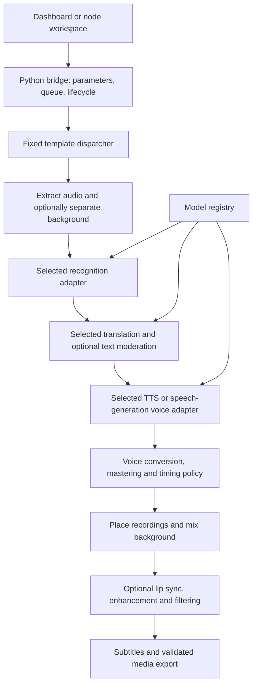

# ReFlow Studio: architecture audit and repair plan

**Date:** 9 October 2026. **Phase:** 1 — inspection and planning. **Decision:** preserve the useful implementation, establish an auditable stage execution contract, then add quality supervision and an optional AI manager. Release readiness remains pending.

## 1. Purpose, method and limits

The intended product is a reusable media pipeline whose engines can be replaced: preprocessing → recognition → translation → dialogue preparation → speech generation → alignment/mixing/export. Users should operate the same pipeline through ordinary controls, a node workspace or an optional API/Ollama manager. A future specialist reviewer model is a research decision, not a prerequisite for the initial product.

This audit inventories 62 important application/build files, inspects the current stage execution and provider boundaries, reads selected runtime/model metadata, and references retained validation evidence. The machine-readable inventory contains source SHA-256 digests and Python symbol locations. It is an inventory of the current **working tree**, not an assertion that every feature in every file has been exhaustively tested.

Base Git commit: `d3408a587f734b99ea6e30cac3c503804677ea98`, branch `master`. There were 374 dirty/untracked status records before these audit artifacts were added. Earlier changes are preserved; no reset, commit or publication was performed. No applicable `AGENTS.md` was found in the checked workspace/parent paths.

No application code was edited, model inference started, dependency installed, model downloaded or file removed during this phase. Interpreter `--version` reads confirmed Python **3.10.11** for the core portable runtime, IndicF5 GPU runtime and IndicTrans2 runtime. Model weights were not rehashed for this audit. Registry inventory omits credentials and complete connection metadata.

Source inventory: [2026-10-09-architecture-inventory.json](<C:/Projects/Reflow Studio/docs/audit/2026-10-09-architecture-inventory.json>). This document distinguishes code presence, prior automated checks, live engine evidence and human acceptance. None substitutes for all the others.

## 2. What currently exists

The application is a Python/pywebview desktop shell with a React/TypeScript frontend. `main.py` finds the frontend build, configures import paths and FFmpeg availability, creates `PythonBridge`, and launches the window. The bridge handles configuration, model connections, graph state, queue management, render ownership and pushed progress events.

The bridge converts a shared frontend parameter object into template-specific arguments. `ReflowPipeline.run` dispatches four predefined templates: video dubbing, video dubbing with lip sync, audio dubbing, and subtitle translation. Video/audio templates are procedural generators. Provider resolution selects implementations through the model registry. They are real connected stages, not just model names displayed in the interface.

This diagram represents the automatic execution path. Saved cue review is a separate durable workflow: prepare → edit/translate → estimate/generate → audition/select → render. Evaluation scripts may import recordings or supply edited text; their outputs must retain that provenance.

## 3. Stage-by-stage implementation map

| Intended responsibility | Current implementation | Status and material limits |
| --- | --- | --- |
| Media inspection/extraction | FFprobe/FFmpeg, duration/stream checks, owned temporary files | Implemented; validation covers known fixtures/media, not every container or clean installation |
| Background separation | Demucs worker, owned checkpoint with checksum, required vocals/background outputs | Implemented; physical/decoded stems do not prove absence of source-speech leakage |
| Recognition | List-compatible `TranscriptionResult`, language/probability metadata, timestamps; faster-whisper, stronger Whisper and REST adapters | Implemented; selected stronger recognizer has a Windows/CUDA runtime route; broad ASR reliability is unproved |
| Sentence grouping | Short-cue merging and sentence-aware grouping; speaker metadata preserved when present | Implemented; grouping does not identify speakers or establish shot boundaries |
| Translation | IndicTrans2, NLLB, Ollama/M2M100, AirLLM and REST routing; source-language checks and token-completion guards | Implemented; selected IndicTrans2 adapter is English→Hindi only; lexical correctness and complete decoding do not certify semantic fidelity |
| Dialogue adaptation | Review text edits and combinations; native duration preflight | **Missing as a reusable automatic adaptation stage**; evaluated concise scripts were editorial work |
| Speech generation | XTTS/IndicF5 TTS adapters; F5 speech generation through a voice adapter; supported cloud shapes | Implemented for specific recipes; naturalness, language and device coverage differ by engine |
| Voice conversion | RVC and service adapters; per-cast provider resolution | Implemented; cast assignment currently rotates by cue, not source speaker identity |
| Timing/mastering | Engine-specific policies, silence borrowing, duration checks, rejection of audible overflow | Implemented; some language-wide pace choices derive from samples; fit is not perceptual synchronization |
| Mix/export | Dynamic background mix, subtitle generation, optional visual stages, staged/validated outputs and stem bundles | Implemented; word-level subtitles, exact shot alignment and voice/background quality are not uniformly validated |
| Saved review | Revision-checked source/translation edits, cue timing edits, combine, audition, acceptance and render | Implemented; cue identity is positional; automatic quality judging is absent |

Preprocessing is not currently a selectable AI-provider stage; FFmpeg and Demucs are invoked directly. Alignment, mixing and export are also pipeline-owned functions. This is acceptable for an initial fixed workflow, but their contracts need to be visible to the planner and quality supervisor.

## 4. Engine replacement: useful foundation, incomplete capability description

`core/providers/base.py` defines stage-shaped interfaces. `core/providers/resolve.py` connects those interfaces to registry selections. `core/model_contract.py` validates the supported artifact/request shapes. A checkpoint cannot be treated as interchangeable merely because a user downloaded it: its architecture, adapter, tokenizer, language coverage and runtime must match.

Existing families include:

- **STT:** faster-whisper, stronger Whisper turbo and supported REST responses.
- **Translation:** NLLB, the selected English→Hindi IndicTrans2 route, default Ollama/M2M100, AirLLM and supported REST responses.
- **TTS:** XTTS, Hindi IndicF5 and supported service request shapes.
- **Voice:** RVC conversion, F5 speech generation and supported service conversion requests.
- **Visual:** Wav2Lip/MuseTalk, GFPGAN, NudeNet/frame classifier and supported REST operations.
- **Text moderation:** local classifier, Ollama or supported REST rewrite/classification paths.

These are available code adapters, not a claim that every provider is installed or validated. The registry currently contains 46 records, including 37 voice records. A record may be uninstalled, invalid or a catalog/test-era entry; these counts are not usable-engine counts.

The active installed selections are stronger Whisper, IndicTrans2 English→Hindi and Abhishek IndicF5. Active visual/lip-sync/text-moderation selections are empty, but enabling certain visual features can still resolve bundled defaults.

Capabilities are scattered across local contracts, language maps, runtime checks, provider attributes and registry metadata. There is no single planner-readable descriptor covering supported inputs, source/target languages, processors, reference requirements, duration estimation, instruction support, conversion-versus-generation behavior and resource evidence.

F5's voice adapter can generate new speech rather than convert existing audio. A future planner must understand that distinction to avoid assuming every voice operation is audio-to-audio. Native Hindi IndicF5 requires an exact confirmed recording/text profile; selecting it does not automatically clone an arbitrary source speaker.

The default Ollama translator can visibly fall back to M2M100 on service failure. Such fallback should become an explicit run-policy decision recorded with the actual engine identity. Fixed-vocabulary translators reject unsupported free-text instructions; they cannot be made agentic simply by adding a prompt field.

## 5. Nodes: fixed configuration graph, not a general executor

`core/graph_model.py` explicitly describes fixed backbone topology. `core/node_registry.py` defines ten kinds: input, separation, recognition, translation, voice, lip sync, enhancement, content filtering, subtitles and output. Optional stages can be toggled. Voice nodes can be duplicated, and each can select a cast voice. Graph positions/values persist through `GraphState`.

The graph is not topologically executed. The bridge/template parameter mapping and procedural pipeline determine execution. Graph serialization stores nodes and values; restoration recreates known edges. Arbitrary user-defined stage wiring, conditional branches and independent stage instances are not supported.

This is a scope boundary, not a reason to discard the graph. Initial manager support can produce a validated **fixed-template plan** that both views show. A full general graph executor is a later, separately justified feature.

Two interface descriptions require attention:

1. The recognition node's readonly default is `Whisper (CPU)` even though the actual selected engine can be stronger Whisper on GPU. The bridge injects voice choices but does not resolve this engine label dynamically in the inspected path.
2. The node choice `CLONED_USER` is labelled `Original speaker`, while selected Hindi IndicF5 uses the confirmed Abhishek profile. That wording can imply source-speaker cloning that this selected route does not perform.

Casting uses `cast_list[index % len(cast_list)]`. Multiple voices therefore mean alternating cue assignments. Existing grouping tolerates `speaker`/`speaker_id` metadata, but the casting operation does not use it. Genuine speaker-preserving dubbing needs speaker→voice assignment and a validated diarization/assignment path.

## 6. Job ownership, persistence and parallel processing

Useful protections already exist: one active bridge render owner, cancellation checks, owned subprocess tracking, unique job/segment workspaces, JSON store validation, revision-based review mutations, staged output publication, queue state, previewed model deletion and preservation of managed jobs during legacy cleanup. Retain these protections during refactoring.

The queue runs jobs sequentially. Within a job, up to eight backend cue workers are accepted, with bounded submission/result buffers and ordered mixing. Shared speech/model inference is locked across CPU and GPU; preparation/mastering can overlap. The worker count is not evidence of parallel model inference or a proportional speed increase. The UI currently exposes a narrower worker choice than the backend limit.

There is no general stage scheduler for resource reservations, distributed execution or simultaneous independent GPU engines. Several stage workers release before the next heavyweight engine loads, which is useful lifecycle management but not a full resource scheduler.

`render_state.py` is explicit: interrupted-render recovery reruns the input/parameters **from the beginning**. There are no stage checkpoints in the automatic workflow. Durable review recordings are different from resumable automatic-stage artifacts.

Frontend render parameters and queue entries are copied/frozen at important boundaries. Engine/settings lookup remains registry/store-driven, with application lifecycle guards. There is no universal persisted snapshot of exact engine identity, reference hashes, effective settings and stage artifacts for every automatic run. This audit does not demonstrate a mid-run race; it identifies the missing auditable snapshot/checkpoint contract.

## 7. Timing and provenance: the central foundation gaps

The automatic path translates by replacing each segment's `text`. A separate canonical source/translated/adapted text record is not retained throughout the normal pipeline. Saved review keeps `source_text` and `text`, but individual cues are identified through list position/revision. A combine/split can change positions. There is no stable cue lineage contract shared across recognition, translation, synthesis and export.

Native IndicF5 predicts its generation budget using the confirmed calibration, sentence UTF-8 length and sentence gaps. Prior output frame counts match that budget. This is not a learned predictor of how a human would naturally time the sentence, and it does not prove every intended word was pronounced clearly. Other TTS routes do not expose the same pre-generation estimate.

The pipeline can use inter-cue silence and can reject speech that would require audible cropping. Current engine-dependent policies differ: native IndicF5 preserves native timing; non-native Hindi paths include the previously reviewed 1.342 pace; other paths use bounded timing adjustment. A language-wide pace should not be treated as a universal voice-quality policy.

The accepted full review has 14 measured available-window fits, but includes explicit editorial wording and a retained shot composition. Cue 12 uses about 0.513 seconds beyond its nominal recognized end, inside the following gap. Human acceptance applies to that specific reviewed render. The raw translator still has only 3/14 fitting translations. The successful manual result must not be promoted as an automatic dialogue-adaptation implementation.

## 8. Resource estimates and actual measurement

The hardware layer detects devices and samples host CPU/RAM. ETA/resource planning uses stage ratios, rough weight footprints, model overrides, processor routes and estimated audio buffers. The bridge explicitly warns that stronger Whisper, IndicTrans2 and IndicF5 startup/speed/memory estimates are uncalibrated. Parallel worker count does not receive an invented inference speed discount.

The benchmark performs a Python loop and GPU matrix multiplication. It does not benchmark each installed media model. `estimate_peak_vram_mb` aggregates rough stage footprints; it is not a measured, liveness-aware peak for the actual serialized execution schedule. Service latency and downloads are excluded.

Main-process PyTorch allocation counters do not directly measure memory allocated inside separate feature workers. An NVIDIA-SMI sampling path exists for a detected unsupported NVIDIA route; comprehensive worker-aware GPU telemetry still needs validation. No assertion is made here that every UI snapshot is wrong.

Needed: per-engine/device measurements for startup, inference time, peak memory and processed workload; observed versus estimated values; unavailable values represented as unknown; resource scheduling that includes the optional local manager when it shares the GPU.

## 9. Runtime, downloads and packaging

The main portable and inspected Hindi evaluation interpreters report Python 3.10.11. Separate environments are intentional because feature dependencies differ; they should not be collapsed into one installation without compatibility evidence.

The selected stronger recognizer resolves to the IndicF5 GPU evaluation runtime. IndicTrans2 uses a specific CUDA/Transformers environment and first NVIDIA GPU. Its current adapter supports English→Hindi. These routes are not general CPU/MPS/cross-platform implementations.

The runtime inventory exposes a readiness inconsistency: IndicTrans2 profile metadata still says `prepared-not-ready`, while retained live validation and active selection show successful inference. Its interpreter resolver checks the executable's presence; the worker enforces its runtime requirements separately. Metadata must become an authoritative, measured capability/readiness record, rather than a stale preparation label. This audit leaves it unchanged.

Downloads include streaming/snapshot paths, ownership, cancellation, staging, network/offline checks and selected asset checksum validation. Integrity checks at normal UI launch do not preload all optional weights. A model download alone does not install every required runtime or grant gated-model access.

The portable builder explicitly includes core application/runtime trees and optionally F5/vision/MuseTalk profiles. Its profile choices do not yet package/provision the connected Hindi evaluation runtimes. The 186-file application refresh is a source/build-copy consistency check; it excludes personal model selections and downloaded weights. It does not establish that a clean machine can obtain and run the current selected Hindi stack.

The CI workflow builds three operating-system artifacts using Python 3.10 and broad requirements. The inspected workflow does **not run the backend tests or full model/media validation**. Windows executable build, Windows portable assembly and Linux/macOS launch/build paths are distinct and need an explicit support matrix. README “self-healing”/cross-platform statements should not imply validated feature parity. Dependency lists include broad/unpinned packages; new installs are not guaranteed to reproduce the working environments.

## 10. Manager and quality supervisor: planned, not implemented

Existing Ollama translation and REST adapters are not an agent manager. No application tool-calling controller, validated prompt→pipeline plan, manager conversation state or bounded quality-correction loop was found in the inspected production path. Agent wording in a reusable frontend demo component does not establish a working product feature.

Current quality checks are structural/operational: valid inputs, language routes, finished translation tokens, playable audio, duration fit, streams, output bounds and hash-bound review. They do not establish translation meaning, speaker identity, emotional delivery or general naturalness. Text moderation is not a translation-quality evaluator.

The proposed quality supervisor must combine actual measurements with model assessment and report uncertainty. Recognizing generated audio can support content diagnostics but can introduce its own errors; agreement between two model outputs is not proof of correctness. A text-only manager cannot directly assess the waveform without audio-capable tools/model input.

A specialist SLM should be evaluated only after a consented, structured dataset exists. Current brief “good” approvals are useful acceptance evidence for specific media, not a fully labelled multilingual training set with independent quality dimensions.

## 11. Evidence ledger

| Evidence | What it establishes | What it does not establish |
| --- | --- | --- |
| `2026-10-09-budgeted-review-backend-final.log`: 581 checks, 80.098 seconds, `OK`; real registry unchanged | Prior regression success for the preceding code checkpoint | Every model/provider, actual GUI or language quality works |
| `2026-10-09-budgeted-review-frontend-build.log` | Prior TypeScript/production-build success | End-user interactions and clean-machine launch |
| `2026-10-09-automatic-hindi-video-be95b2d4.json` | Fresh 4-second automatic backend run using saved engines and automatic reference | Full-video raw-translation timing or another independent source |
| `2026-10-09-budgeted-hindi-review-6608ce68.json` | 13 fresh speech takes, one retained reviewed composition, 14 measured window fits and full export | Untouched automatic translation/adaptation |
| `2026-10-09-budgeted-hindi-full-video-user-feedback.json` | User accepted the particular complete reviewed candidate | Independent sources, all quality dimensions or release approval |
| `2026-10-09-budgeted-hindi-review-6608ce68-audit.json` | Hash/read-back checks, baseline sample identity and Hindi recognition diagnostic | Human naturalness or precise audiovisual alignment measurement |
| `2026-10-09-budgeted-review-portable-refresh.json` | Prior 186-file app copy, no size mismatches | Self-contained install of the selected Hindi runtimes |
| This phase's source/runtime inventory | Current source symbols/hashes, selected registry summary, version reads | Fresh backend tests, model inference or weight integrity verification |

Earlier attempts on other available sample files produced unreliable/low-confidence recognition and did not establish another independent successful workflow. They remain failed/limited evidence, not silently counted as passes. This phase did not rerun tests: it changes documentation only.

## 12. Recommended repair order

These are proposed work items, not completed implementations. P1 means a foundation/product gap that blocks the agreed architecture; P2 means subsequent validation/usability/release work, not an emergency incident rating.

| ID | Priority | Work item | Required proof |
| --- | --- | --- | --- |
| A01 | P1 | Introduce versioned pipeline/run/cue/artifact contracts with stable cue IDs and text lineage | Source, translation and adaptations remain distinct; combining/splitting keeps lineage; legacy adapters normalize correctly |
| A02 | P1 | Compile one fixed-template plan from Dashboard, Nodes or future manager input; snapshot exact engines/settings | All entry points execute the same plan; unsupported stages/languages/device combinations fail before work |
| A03 | P1 | Record actual stage outputs, engine identities, failures, timings and artifact hashes in a durable run manifest | A fresh automatic run is independently inspectable; imported/editorial media cannot masquerade as inference |
| A04 | P1 | Add stage checkpoint/invalidation rules and restart only affected work | Translation edit reuses valid preprocessing/STT; failed TTS retries only affected cues; changed source/model invalidates dependent results |
| A05 | P1 | Separate dialogue adaptation and engine-specific timing policies from the procedural dub loop | Real overflow cases produce meaningful fitting dialogue or an explicit review state; no hidden truncation/cropping/global voice recipe |
| A06 | P1 | Build quality reports first, then bounded targeted corrections | Failures identify evidence and responsible stages; retain best candidate; stop at budget or uncertainty instead of endless retries |
| A07 | P2 | Centralize engine/runtime capabilities and readiness; repair misleading engine/voice labels | Selected GPU/preset voice is accurately represented; readiness reflects actual checks; unsupported CPU/MPS/OS routes are explicit |
| A08 | P2 | Measure engine/device workload and make telemetry/scheduling worker-aware | Estimates versus actuals are recorded; no false parallel speedup; manager and media engines obey shared capacity |
| A09 | P2 | Introduce speaker identity→voice mapping before claiming multi-speaker fidelity | Repeated speaker keeps one voice despite cue splits; round-robin remains an explicit mode if retained |
| A10 | P2 | Add optional API/Ollama manager on the validated application operations | Prompt→validated plan→execution→honest reporting; no arbitrary unsupported edits or synthetic success claims |
| A11 | P2 | Formalize runtime provisioning, dependency recipes, CI tests and platform release gates | Fresh Windows portable start and feature provisioning work; Linux/macOS claims have separate evidence |
| A12 | Deferred | Benchmark/fine-tune a specialist quality reviewer if justified | Consent/data provenance, held-out multilingual evaluation and improvement over existing evaluation approach |

Initial implementation should cover A01–A03 together in small reviewable changes. They provide the evidence needed to implement/check later repairs. Engine readiness/UI corrections in A07 can accompany the relevant contract work. A04 then enables economical experimentation. A05/A06 address actual automatic quality. A10 follows a usable set of application operations; it does not bypass them.

## 13. Proposed contracts and boundaries for Phase 2

The following names are design proposals, not existing APIs:

- **PipelineSpec v1:** template, source reference, selected stage connections, parameters, explicit fallback policy, language route and resource/retry limits. Initially fixed supported templates, not arbitrary executable graph code.
- **RunManifest v1:** run ID, exact compiled plan and source hash; stage statuses; actual engine/runtime/reference identities; artifact references; effective settings; timing/resource observations; errors and human/editorial provenance.
- **Cue v1:** immutable cue ID, parent/lineage IDs, original timings, optional speaker ID, source text, raw translated text, proposed adapted text and revisions. Display position is separate from identity.
- **SpeechArtifact v1:** cue/text revision, actual engine/reference identity, sample rate/channels/frame count, duration, hash, generation settings and acceptance origin.
- **QualityReport v1:** criterion, scope, observed values/evidence, threshold or evaluator identity, uncertainty and recommended stage action. Structural failure, model assessment and human approval stay distinct.
- **EngineCapabilities v1:** supported stage/data shape/languages/devices/platforms, reference needs, instruction support, optional duration-estimate capability, installation/readiness and measured resource profile.

Adapters can retain their current stage-shaped methods. Normalization wrappers should produce the new records without requiring every engine to be rewritten. Unknown capabilities/measurements remain unknown; the planner cannot invent them. Secrets remain in the credential store, not run logs.

The controller determines valid transitions, resource ownership, cancellation, retry caps and artifact publication. The AI manager proposes plans/actions and communicates results. The quality supervisor inspects stage evidence and can recommend or request an allowed correction. The media engines perform inference. Manual review is a supported product path with explicit provenance, not hidden fixture input.

## 14. Acceptance gates for the next development iteration

1. Define the contracts and compatibility mapping using the existing four templates; preserve current valid parameter behavior.
2. Add meaningful tests for immutable source/raw text, cue lineage, engine capability rejection, run snapshot identity and failure reporting.
3. Run an original known video through actual app selections. Save all real stage evidence without substituted text/audio or video-specific placements. A timing failure is recorded honestly rather than repaired outside the app.
4. Demonstrate another independent usable source before generalizing reliability. If existing samples fail speech recognition, document that failure and obtain a suitable source rather than force a language or fabricated transcript.
5. Introduce checkpoints and adaptation only once their inputs/outputs can be audited; compare against the accepted full Hindi video as a baseline, not as imported generated output.
6. Request listening review at meaningful milestones, naming the software change and quality question. Human feedback is tied to the exact output. Avoid prolonged regeneration without a reusable feature objective.
7. Explain any proposed additional tool/framework/model, its role, cost/dependency impact and alternatives before seeking user approval. No new dependency is assumed necessary for the contract/inventory work.

## 15. Preserve, defer and do not mistake for completion

Preserve provider adapters, validated language/reference guards, staged outputs, cancellation/owned workers, durable review tools, JSON persistence, model-download protections, queue controls and the accepted comparison media. Their existence reduces the amount of work needed.

Defer training an SLM, arbitrary graph execution, distributed rendering and new target-language quality claims until the foundational automatic workflow and evaluation evidence support them. Do not perform another one-video polish cycle as a substitute for A01–A06.

Keep evaluation scripts and historical receipts, clearly labelled as evidence. They should not become hidden production dependencies. Catalog entries, brand/demo UI components, build success and synthetic benchmarks do not establish engine/agent capabilities. This phase makes no deletion recommendation based only on static keyword search; dependency/unused-code cleanup needs import/runtime evidence.

## 16. Source navigation and audit deliverables

Key inspected boundaries:

- [App startup](<C:/Projects/Reflow Studio/main.py:128>) and [bridge template execution](<C:/Projects/Reflow Studio/bridge/api.py:1693>).
- [Parameter mapping](<C:/Projects/Reflow Studio/bridge/api.py:1576>) and [automatic video sequence](<C:/Projects/Reflow Studio/core/pipeline.py:755>).
- [Provider interfaces](<C:/Projects/Reflow Studio/core/providers/base.py:21>) and [translation/TTS resolution](<C:/Projects/Reflow Studio/core/providers/resolve.py:99>).
- [Fixed graph scope](<C:/Projects/Reflow Studio/core/graph_model.py:1>), [node definitions](<C:/Projects/Reflow Studio/core/node_registry.py:1>) and [graph bridge](<C:/Projects/Reflow Studio/bridge/api.py:1116>).
- [Cue voice/timing policy](<C:/Projects/Reflow Studio/core/pipeline.py:358>) and [bounded cue workers](<C:/Projects/Reflow Studio/core/pipeline.py:514>).
- [Saved review preparation](<C:/Projects/Reflow Studio/core/cue_review.py:303>), [timing estimate](<C:/Projects/Reflow Studio/core/cue_review.py:402>) and [review operations](<C:/Projects/Reflow Studio/core/cue_review.py:424>).
- [Restart-only recovery](<C:/Projects/Reflow Studio/core/render_state.py:1>), [job ownership](<C:/Projects/Reflow Studio/core/render_context.py:40>) and [native budget calculation](<C:/Projects/Reflow Studio/core/indicf5_duration.py:1>).
- [Resource planning](<C:/Projects/Reflow Studio/bridge/api.py:500>), [hardware telemetry](<C:/Projects/Reflow Studio/core/hardware_monitor.py:219>) and [synthetic benchmark](<C:/Projects/Reflow Studio/core/hardware_monitor.py:287>).
- [Optional Windows runtime resolution](<C:/Projects/Reflow Studio/core/optional_runtime.py:13>), [portable packaging](<C:/Projects/Reflow Studio/packaging/build_portable.py:1>) and [build-only CI](<C:/Projects/Reflow Studio/.github/workflows/build.yml:1>).

Deliverables are this report and the source/runtime inventory. Implementation begins only after the proposed repair sequence is settled; this document does not mark the future modules as built.

### Follow-up after plan approval

The first implementation increment is documented in [Pipeline foundation iteration](<C:/Projects/Reflow Studio/docs/PIPELINE_FOUNDATION_ITERATION_2026-10-09.md>). It connects shared fixed plans, frozen selections, automatic cue provenance and durable execution observations. The inventory above remains the pre-implementation audit snapshot; its hashes are intentionally preserved. Checkpoints, general quality supervision and the AI manager remain future work.

### Stage recovery and saved-review provenance follow-up

The next increment adds verified recognition/translation checkpoint reuse for the selected local Whisper Turbo and IndicTrans2 engines, plus stable canonical cue contracts for saved review edits and combinations. [The detailed recovery iteration](<C:/Projects/Reflow Studio/docs/STAGE_CHECKPOINTS_ITERATION_2026-10-09.md>) documents eligibility, invalidation, legacy migration, validation and remaining limits. The original inventory is still the pre-implementation snapshot. Automatic dialogue adaptation, general quality supervision and the optional AI manager remain future work.

### Dialogue assessment and bounded-review follow-up

The next increment implements all-cue native timing reports for automatic audio/video dubbing, manifest review requirements and on-demand unapproved IndicTrans2 wording alternatives in saved cue reviews. [The detailed iteration](<C:/Projects/Reflow Studio/docs/DIALOGUE_ADAPTATION_ITERATION_2026-10-09.md>) documents the stateful processor deadlock found and repaired, bounded execution, real-model evidence and remaining scope. All 641 backend tests and frontend build/lint passed. The real 14-cue raw translation has 11 timing conflicts; alternatives for the first three conflicts did not fit. A05/A06 are partial: automatic semantic shortening and naturalness supervision remain open. No new model/tool/framework was installed, and the accepted editorial video is unchanged.

### Supervision contract preparation — model choice pending

A service-neutral bounded writer/meaning-review contract is prepared, with 23 focused assessment/supervision tests passing. It does not enable a new model or automatic rewriting. The user chose to discuss API/local-model options before adding anything. [The preparation report](<C:/Projects/Reflow Studio/docs/DIALOGUE_SUPERVISION_PREPARATION_2026-10-09.md>) records scope, fixtures, real-service availability, options and the evidence needed before activation. A05/A06 remain partial.

### Hybrid assistance configuration implemented — 9 October 2026

The user selected optional hybrid assistance. Settings now expose Off/Local/Hybrid modes, independent writer/reviewer connections and consent tied to selected provider/model/endpoint details. The chat adapter reuses existing HTTP/credentials, has bounded responses and no fallback, and was verified through actual disposable loopback HTTP. All 673 backend tests and frontend build/lint passed. [The detailed connection iteration](<C:/Projects/Reflow Studio/docs/HYBRID_DIALOGUE_CONNECTIONS_ITERATION_2026-10-09.md>) records consent, protocol and timeout limits. Normal pipeline/review invocation remains pending real-model selection and evaluation. No model/package installation or paid provider call was made; A05/A06 and release gates remain partial.

### Explicit assisted cue review and setup inspection — 9 October 2026

Hybrid assistance is now connected to an explicit saved-cue review action with per-request disclosure, frozen configuration, revision/consent guards, durable unapproved reports and manual wording selection. Ordinary pipelines do not invoke it automatically. **684 tests across 38 modules passed**, plus frontend build/lint. [The assisted-review iteration](<C:/Projects/Reflow Studio/docs/ASSISTED_CUE_REVIEW_ITERATION_2026-10-09.md>) records persistence, races, invalidation and fixture/live-evaluation boundaries. The user chose to defer live model calls and installations.

A07 now has an advisory Dashboard setup inspection using shared plans, snapshots, file contracts, language checks and existing interpreter resolvers. It distinguishes checked files from unverified runtime/provider/hardware behavior and identifies actual Whisper Turbo/IndicF5 device routing. [The setup iteration](<C:/Projects/Reflow Studio/docs/ENGINE_SETUP_INSPECTION_ITERATION_2026-10-09.md>) records installed-selection observations and remaining capability work. No inference/download/provider call is needed for inspection. A05/A06/A07 and release remain partial.

Final setup-increment validation passed **694 tests across 39 modules in 107.359 seconds**, plus frontend build/lint, preserving settings/registry and accepted video. The first full run had one Windows directory-publication access error; ten isolated repeats and a complete rerun passed without source changes. Failed evidence is retained and the cause remains unconfirmed.

### Selected-runtime smoke checks — 9 October 2026

A07 now includes explicit dependency/device checks for the existing pinned Whisper Turbo, IndicTrans2 and IndicF5 routes. Each has passed an actual import/pinned-version/RTX 4060 arithmetic check in retained individual runs, with no weights loaded or model/API calls. The checker accepts IndicTrans2's existing shared CUDA package layout. A traced broad F5 training-dependency import justified a 90-second Hindi check budget; recognition/translation retain 45-second limits. Timeouts remain unverified rather than being mislabeled broken installations. Existing job/deletion guards reserve the application during these checks. [The detailed runtime iteration](<C:/Projects/Reflow Studio/docs/RUNTIME_DEPENDENCY_CHECK_ITERATION_2026-10-09.md>) preserves incomplete runs, diagnostic traces, successful observations and final regression evidence.

These are selected-route smoke checks, not model loading, acoustic/translation quality, platform-wide capability validation or release readiness. Remaining engines, runtime profile authority, measured resource profiles and end-to-end independent-input gates remain open. No package/model installation or live provider call was made.

Final validation passed **707 tests across 40 modules in 97.391 seconds**, plus frontend build/lint, with source/settings/registry/accepted-video integrity preserved. IndicF5's measured check passed in 49.093 seconds with the corrected budget. The earlier Windows publication error did not recur and remains unexplained.

### Bounded Windows publication recovery — 9 October 2026

Actual disposable Windows handles reproduced the historical WinError 5 directory-publication error by denying delete sharing on a child review file. Job publication now retries only recognized Windows access/sharing denials, at most four attempts with 350 ms total wait, releasing the cancellation lock between attempts. Persistent/unknown failures and directory conflicts remain explicit. Actual review preparation recovered after releasing its staged-file handle and retained its persistence/audio assertions. **717 tests across 41 modules passed in 111.047 seconds**, with state/source/video integrity preserved. [The publication iteration](<C:/Projects/Reflow Studio/docs/WINDOWS_PUBLICATION_ITERATION_2026-10-09.md>) records real reproduction, cancellation, preservation and limits. The historical lock owner remains unknown; this is protection against proven transient-lock cases, not a universal explanation. No model/API calls, downloads or installations occurred.

### Optional engine dependency coverage — 9 October 2026

Selected-setup runtime checks now cover generic F5, MuseTalk, NudeNet, RVC, GFPGAN, Wav2Lip and image/text classifiers using fixed, bounded dependency/device checks. Built-in stage fallbacks are included. In-process engines use the actual app interpreter; a worker override cannot establish their readiness, and frozen in-process environments remain explicitly unverified. Identical checks are reused only within one inspection, with independent result copies per voice. No API request, model loading, download or installation was performed.

Actual existing CPU checks passed for NudeNet, RVC, GFPGAN and Wav2Lip. Generic F5 and MuseTalk timed out at 90 seconds and remain unverified; a timeout does not establish a broken engine. Optional CUDA environments, checkpoint loading/rendering, background separation, wider platform coverage and independent full-video acceptance remain open. Live assistance evaluation remains deferred at the user's request.

Final validation passed **726 tests across 41 modules in 111.922 seconds**, plus frontend build/lint. Tested-source, saved-state and accepted-video integrity passed. [The detailed optional-engine report](<C:/Projects/Reflow Studio/docs/OPTIONAL_ENGINE_READINESS_ITERATION_2026-10-09.md>) records exact routes, interpreter choices, actual observations and remaining limits. A07 remains partial and release readiness remains **pending**.

### Bundled optional workflow checks and retained import diagnostics — 9 October 2026

Runtime inspection now verifies the generic F5 synthesis interfaces and imports MuseTalk's actual bundled workflow with origin/entry-point checks, without constructing models or invoking inference. MuseTalk's expanded installed CPU check passed in 39.797 seconds. Generic F5 remained incomplete at 90 seconds; snapshots show progressing imports, not an established deadlock or corrupt installation. Its readiness remains unverified. The prior incomplete observations remain preserved separately.

The first full regression run exposed five Windows stdout encoding errors in the standalone verification runner. The normal application already initializes UTF-8. The runner now mirrors that configuration, and its failed receipt is preserved. The corrected final run passed **729 tests across 41 modules in 107.656 seconds**; focused checks passed 35 tests. Saved-state, tested-source and accepted-video integrity passed. No frontend/dependency changes, downloads, model loading or live provider calls occurred.

[The detailed workflow-import iteration](<C:/Projects/Reflow Studio/docs/OPTIONAL_WORKFLOW_IMPORT_ITERATION_2026-10-09.md>) records both diagnostic runs, limits and the harness correction. Model-backed rendering, wider device/platform coverage, independent full-video acceptance and live assisted-review quality remain open. A07 stays partial; release readiness remains **pending**.

### Translation-stage failure/close recovery — 9 October 2026

Translation's existing IndicTrans2 worker release is now guaranteed at the owning stage boundary for success, failure, cancellation and subtitle-generator close across audio/video/subtitle runs and review preparation. Cleanup failures during unwinding retain the original failure and log only their type; cleanup failure after success remains explicit before later work proceeds. Video release now occurs before subtitle writing. Other providers' lifecycle protocols and universal media-stage resume are not added by this change.

A synthetic PCM/provider-fixture restart test verified that a failed second translation cue leaves completed recognition reusable, does not publish partial translation, and retranslates the full batch on a new run. Recognition was called once across the two runs, translation four times and release twice. This is control-flow/cache evidence, not live model quality. Subtitle close records cancellation/restores selection; failed review preparation preserves the earlier review.

Focused validation passed **103 tests in 23.456 seconds**; full validation passed **733 tests across 41 modules in 104.297 seconds**. Tested-source, saved-state and accepted-video integrity passed. An initial focused invocation failed on denied renames in the sandbox's default temporary directory; its log is preserved, and final runs use project-owned disposable fixtures. No frontend/dependency change, model inference, download, installation or external provider call occurred. [The detailed stage-recovery report](<C:/Projects/Reflow Studio/docs/STAGE_RECOVERY_ITERATION_2026-10-09.md>) records the stage map, scope, repair, evidence and remaining gates. Wider resource/provider/platform and independent video/quality validation remain open; release readiness remains **pending**.

### Mixed processor budgets and shared parallel bounds — 9 October 2026

Resource planning now splits base speech and requested voice-conversion components by the processors used in execution, including separately selected IndicF5 devices for non-cloned actors and optional CPU F5 mixed with GPU speech. CPU components no longer receive another component's GPU timing discount or count against its GPU budget. Duplicate voice IDs count once; all-F5 casts omit unrelated active base speech. GPU model budgets are grouped by device, with missing estimates marked unknown rather than zero. The legacy aggregate remains for response compatibility; Dashboard/Nodes use the selected processor's own budget.

Scheduling and buffer estimates share the existing 1–8 worker policy and bounded segment window (one sequential, twice workers for parallel). Worker count does not imply measured model speedup or multiply model VRAM. Text-only internal estimates count no audio buffers. Nine-second clip assumptions, additional model memory and uncalibrated cumulative GPU budgets are explicit. The shared frontend calculation refuses missing/invalid memory or telemetry; stale asynchronous results cannot overwrite newer selections. Interactive UI and physical multiple-GPU acceptance are still open.

Final validation passed **742 tests across 42 modules in 102.688 seconds**, plus 81 focused tests, eight source-bound frontend helper checks, production frontend build and lint. Tested-source, saved-state and accepted-video integrity passed. No model inference, installations, downloads or external provider requests occurred. [The detailed resource-routing report](<C:/Projects/Reflow Studio/docs/RESOURCE_ROUTING_ITERATION_2026-10-09.md>) records assumptions, source changes, API compatibility and remaining limits. Actual throughput/activation/CPU-model/service-resource calibration and independent video/quality validation remain pending; release readiness remains **pending**.

### Actual portable UI walkthrough — 10 October 2026

The existing native Windows app was launched and inspected across Basic/Advanced Dashboard, Nodes, Assets and Marketplace. Missing default reference-audio voice selection was restored and its visible value verified after a rebuild/restart. The recognition node now displays the selected engine's name instead of always claiming Whisper CPU; an in-memory regression covers selection, fallback and stored-value preservation. Frontend build/lint and all **743 backend tests across 42 modules in 108.610 seconds** passed. No live inference, model download, new installation or paid provider request occurred.

The private WebView reset Advanced to Basic on restart, exposing a preference-persistence gap. Source inspection also found graph-language/single-voice configuration mirror concerns; they are not yet repaired or interactively reproduced. Native file selection opened/cancelled, but unreliable automation focus prevented source selection, so populated estimates and active queue/recovery controls remain acceptance gates. Three existing state files and the accepted video stayed unchanged; startup created the previously absent graph.json. [The detailed walkthrough report](<C:/Projects/Reflow Studio/docs/UI_WALKTHROUGH_ITERATION_2026-10-10.md>) distinguishes verified behavior, repaired code, tool limitations and remaining work. Release readiness remains **pending**.

### Preference persistence and graph configuration — 10 October 2026

App-owned UI state now uses a validated transactional ui_preferences.json while the WebView remains private. Preferences hydrate before React mounts; writes are ordered and the normal close button waits for them. Actual portable close/relaunch preserved Advanced mode, and Basic was restored after testing. Graph language/source labels and singleton voice display follow shared render settings; singleton edits update the render choice, duplication saves the current base voice, and removal to one actor restores its choice. Multiple actor choices remain independent; complete native actor-edit acceptance is still open.

All 747 backend tests across 43 modules in 97.031 seconds, eight frontend runtime checks, production build and lint passed. Existing settings/registry/hardware/graph and accepted video unchanged; the new preference file is an intentional state addition. No live model calls, packages or downloads. See [detailed iteration](<C:/Projects/Reflow Studio/docs/PREFERENCE_GRAPH_ITERATION_2026-10-10.md>) for exact evidence, failed-lint-invocation retention, native automation limits and remaining gates. Release readiness remains pending.

## Graph cast estimate follow-up — 10 October 2026

Both public estimate endpoints now resolve the same graph-owned multiple-actor cast as render acceptance; singleton selection continues to use Dashboard. Nodes requests refreshed estimates when actor choices/count change. Queue inspection confirmed completed history is excluded from pending batch-start IDs. A pre-existing Windows publication fixture was corrected to account for real sharing denials after its injected failures without increasing production's four-attempt bound.

Final validation passed 748 tests across 43 modules in 105.360 seconds, ten focused routing tests, production frontend build and lint. Initial failure evidence is preserved. Tested source, prior recorded state and accepted video integrity passed. No native controls/model inference/installations/downloads were exercised in this iteration. Native source/queue/recovery acceptance, resource calibration and model/platform release checks remain open. See [detailed control-path report](<C:/Projects/Reflow Studio/docs/CONTROL_PATHS_ITERATION_2026-10-10.md>).

## Native source and recovery follow-up — 10 October 2026

Fixed accidental recovery deletion on Escape/close/outside dismissal by separating dismissal from explicit Discard while preserving the existing boolean confirmation API. Native disposable-state acceptance verified successful file selection, pending batch confirmation, rejected-start draft rollback, Escape retaining recovery and rejected Resume retaining its record. Model execution was blocked before workers started; this does not validate an active real render or crash recovery.

748 backend tests across 43 modules passed in 95.000 seconds, alongside eight actual-module frontend checks, build and lint. Source/state/video integrity passed. No packages, models or downloads were added. The three fixture windows are closed; their state and receipts are retained. See [detailed native recovery iteration](<C:/Projects/Reflow Studio/docs/NATIVE_RECOVERY_ITERATION_2026-10-10.md>) for scope and remaining acceptance gates.

## Graph switch projection and native estimates — 10 October 2026

Mapped optional switches now project directly from shared render flags, preventing late graph loads from overwriting their displayed state. Rejected graph-mirror saves surface a warning while retaining the future-job configuration that actually governs render parameters. The graph minimum zoom was lowered after a native minimum-width clipping observation.

Native isolated controls verified restored Hindi/English selections, a populated CPU estimate, voice duplication and an independent second actor, four workers, and matching estimate/render cast IDs. Audio-buffer heuristics rose from 2.6 to 14.1 MB without an assumed inference speedup. Model execution was blocked. Final validation passed 748 backend tests across 43 modules in 93.562 seconds, eight frontend runtime checks, build/lint and source/state/video integrity. [Detailed graph-controls iteration](<C:/Projects/Reflow Studio/docs/GRAPH_CONTROLS_ITERATION_2026-10-10.md>) distinguishes native observations, fixture limits, initial harness failures and remaining layout/active-work/platform gates.

## Graph layout and singleton controls — 10 October 2026

Moved resource controls and the render footer outside the Nodes canvas, preventing stage obstruction. Active highlights and edge animation now reflect current render state even after a late graph response. Nine frontend contracts, build and lint pass. Native fixture checks confirm subtitle-off propagation into guarded render parameters and singleton actor changes shared by graph, Dashboard and estimates. No model execution or new dependencies. See [iteration report](GRAPH_LAYOUT_ITERATION_2026-10-10.md) for isolation, evidence and limitations. Layout at other sizes, remaining controls, active rendering/recovery and release validation remain open.

## Language and optional-stage controls — 10 October 2026

Native fixture checks now cover source Auto, Spanish target selection, optional-stage/export flags through Dashboard, graph, estimates and a guarded render request, plus a visible rejected direct-node edit. Bridge exceptions are explained and stale graph reads cannot overwrite newer reloads. Fourteen frontend contracts, 39 focused backend tests, build and lint pass. User state/video remain unchanged; no models or dependencies added. Native deletion, simultaneous mutations, active-job recovery and genuine model/render validation remain open. See [remaining controls iteration](REMAINING_CONTROLS_ITERATION_2026-10-10.md).

## Active worker lifecycle — 10 October 2026

Fixed the active input label, accessible progress value and Assets pending-stop message. Native synthetic payloads running inside the real bridge outer worker verified stopping guards, cancellation, batch resume, completion and marker cleanup. A separate abrupt-process-exit/restart test preserved the current render recovery record. Seventeen frontend contracts, 54 focused backend tests, build/lint and state/source/video integrity pass. No live models or dependencies; full backend suite was not rerun. Real model cancellation/checkpoint reuse, remaining batch crash persistence, native pause/failure advancement and clean-machine release validation remain open. See [detailed active-worker iteration](ACTIVE_WORKER_ITERATION_2026-10-10.md).

## Durable queue and token-based recovery — 10 October 2026

Accepted queue items now persist through the existing atomic JSON store and restore paused with their IDs/settings intact. Recovery restarts the original queued job through its saved token; other jobs wait for explicit batch Resume. Terminal-save failures halt advancement and retain the unsaved job for review. Synthetic process crash/restart evidence covers current-only resume followed by failure advancement to the third job. Full-suite validation also exposed Windows cue-review publication/read races, addressed with the existing atomic writer and a stable shared read/write transaction lock. Final validation counts and retained unsuccessful attempts are in the [detailed durable-queue report](DURABLE_QUEUE_ITERATION_2026-10-10.md) and its receipts. Native restored-control acceptance, real model/checkpoint validation and release packaging remain open; no new dependencies or live models.

## Native restored-batch acceptance — 10 October 2026

The rebuilt Windows interface now has native acceptance for restored paused jobs, original-item Resume Render, explicit Resume Batch, Pause After Current and advancement after a deliberate middle-job failure. Four synthetic jobs finished Completed/Completed/Failed/Completed; the worker was idle and the recovery marker cleared. All 26 retained-evidence checks passed, including original IDs/parameters, unchanged saved state/video and unchanged previously tested sources. No production code, dependencies or live inference changed. The native marker was seeded; genuine synthetic process-crash coverage belongs to the preceding iteration. Dashboard's distinction between selected next input and active input remains a clarity follow-up. Real provider cancellation/checkpoints, measured resources, fresh full-video quality, multiple-instance behavior and platform packaging remain open. See [native batch report](NATIVE_BATCH_RECOVERY_ITERATION_2026-10-10.md).

## Dashboard active versus selected input — 12 October 2026

Dashboard now names the currently rendering/stopping input separately from the next pending selection. Estimates identify the selected input/settings, and accepted-job configuration is distinguished from settings for new jobs. Four actual-component contracts, production build/lint and saved-state/video/source integrity passed. Queue/worker/backend behavior did not change; no backend or native rerun and no models/dependencies added. Native layout and the remaining real-engine/resource/platform release gates remain open. See [Dashboard iteration](DASHBOARD_INPUT_CLARITY_ITERATION_2026-10-12.md).

## Installed-engine pipeline and recovery — 12 October 2026

Native Dashboard acceptance now covers active-versus-pending input and the completed historical label. Real offline Demucs/Whisper Turbo/IndicTrans2/IndicF5 execution exposed nondeterministic Demucs stabilization, repaired with a fixed worker seed. Repeated CPU separation is byte-identical; real speech cancellation cleans up in 0.234 seconds, and the fixed-code restart hits recognition/translation checkpoints and generates new speech. The 6.9-second video passes 15 output/recovery checks and received the user's review: “Natural, timing matches, no English audible.” Final validation passed 763 backend tests across 44 modules and 13 integrity checks; saved user state/video remain unchanged. Original false driver receipts are preserved because a stem-bundle lookup bug was corrected in verification tooling; independent acceptance is recorded separately. A dense eight-second line still needs 10.027 seconds and correctly blocks before speech. Meaning-preserving duration adaptation/cue review is now the leading functional gap. Real native model-running crash recovery, long/noisy/multispeaker video quality, measured resources, optional stages, other languages and clean-platform packaging remain open. See [live workflow report](LIVE_WORKFLOW_ITERATION_2026-10-12.md).

## Timing-aware translation and video review — 12 October 2026

Dashboard now exposes existing single-voice review for standard video dubbing. A fresh offline IndicTrans2 alternatives request on the overflowing cue produced two distinct variants; neither fits eight seconds (10.027/10.304 seconds predicted). The source fragment is also incomplete, requiring surrounding context for meaning review. Six frontend contracts, 89 focused backend tests, build/lint and six integrity checks passed. No wording was applied, speech regenerated or models installed; saved state/accepted video remain unchanged. Automatic shortening needs an explicitly approved instruction writer/reviewer connection. A concrete local evaluation proposal is documented for discussion in the [timing iteration](TIMING_TRANSLATION_ITERATION_2026-10-12.md); no installation has occurred.
